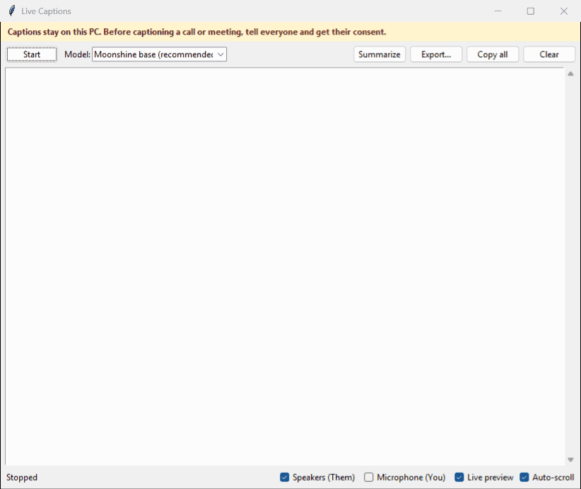
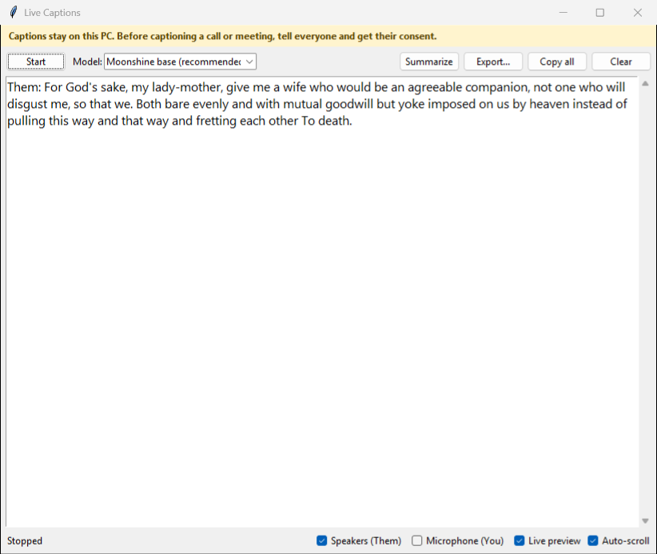
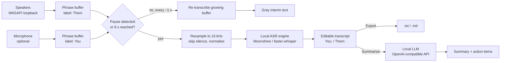

# Live Captions

[](https://github.com/tomjose-bv/live-captions/actions/workflows/ci.yml) [](LICENSE)

Real-time captions for anything your Windows PC plays or hears — meetings, videos,
podcasts — **running entirely on your own machine.**

Live Captions captures your speaker output (and optionally your microphone), transcribes
it locally on the CPU, and shows the text in an editable window. No audio or text leaves
your PC, nothing is saved unless you export it, and it works offline once the models are
downloaded. It also ships with `livecaptions-bench`, a small reproducible benchmark that
measures accuracy, latency and CPU cost of local speech-to-text engines on your hardware.



*A real capture: Moonshine base, speakers only, captioning an 18-second LibriSpeech test-clean clip played through the default output device. Grey italic text is the live preview. It can wobble (here it briefly repeats a phrase) before the speaker pauses and the final text replaces it.*

## Why

Built-in captioning is tied to specific apps, often needs the cloud, and rarely lets you
keep or edit the text. Live Captions works with *any* audio your PC plays, keeps the
transcript in a plain editable box you control, and is open about how accurate and how
fast each model actually is on ordinary laptop hardware.

## Features

- **Captions any app** — WASAPI loopback capture of your default speakers.
- **Both sides of a call** — optional microphone capture; lines are labelled
  **You:** (mic) and **Them:** (speakers). No diarization model or account needed.
- **Live preview** — grey interim text while someone is talking, finalised in black when
  they pause.
- **Local speech recognition** — Moonshine (ONNX) or faster-whisper (CTranslate2, int8),
  English models, CPU only. Pick the speed/accuracy trade-off from the benchmark below.
- **Pause-aware chunking** with an adaptive noise floor per device, so quiet laptop mic
  arrays still work.
- **Editable transcript** with Copy all, Clear and **Export…** to `.txt` or `.md`.
- **Optional summaries & action items** from a local LLM through any OpenAI-compatible
  endpoint (default: [Ollama](https://ollama.com) on `localhost`). The app works fine
  without it.
- **Consent built in** — first-run notice and a persistent banner that turns red while
  captioning.
- **Benchmark harness** — `livecaptions-bench` reports WER, real-time factor, per-chunk
  latency p50/p95, CPU cost, model size and memory on a LibriSpeech subset.

## Quickstart

Requirements: Windows 10/11, Python 3.10+ (3.12 recommended), ~1 GB disk for models.

```powershell
git clone https://github.com/tomjose-bv/live-captions.git
cd live-captions
powershell -ExecutionPolicy Bypass -File scripts\setup.ps1 -Run
```

The setup script creates `.venv`, installs pinned dependencies, copies `.env.example` to
`.env`, runs the tests and (with `-Run`) starts the app. Afterwards, start it with
`.venv\Scripts\livecaptions.exe` (no console window) — pin that to your taskbar if you like.
Models download automatically the first time you press **Start**.



*After clicking **Stop**: the transcript stays in an editable box until you copy, export or clear it.*

Manual install: `python -m venv .venv`, then
`.venv\Scripts\pip install -r requirements.txt -e ".[bench,dev]"`.
The old `pythonw live_captions.py` launcher still works.

### Optional: summaries

1. Install [Ollama](https://ollama.com) and run `ollama pull llama3.2:3b`.
2. Leave Ollama running and click **Summarize**.

Any other OpenAI-compatible local server works too — set `LLM_BASE_URL` and `LLM_MODEL`
in `.env`. If the endpoint isn't on `localhost`, the app asks before sending the transcript.

## How it works



1. **Capture.** PyAudioWPatch opens a WASAPI loopback stream on the default output device
   and, optionally, the default microphone. Each device has its own buffer.
2. **Chunk.** Audio is downmixed to mono and buffered until a pause (quiet tail or gap in
   callbacks), 8 s of continuous speech, or 1.5 s of idle.
3. **Preview.** While a phrase is still growing, the buffer is re-transcribed about once a
   second (backing off automatically on slower models) and shown as grey interim text.
4. **Transcribe.** The finished chunk is resampled to 16 kHz, silent chunks are skipped,
   quiet audio is normalised, and Silero VAD trims non-speech before Moonshine or
   faster-whisper produces the final text.
5. **Show.** Text is appended under a **You:** or **Them:** label depending on which device
   it came from.

Code layout: `src/livecaptions/` — `audio.py` (capture), `chunking.py` (pure buffering
logic), `engines.py`, `transcriber.py`, `ui.py`, `summarize.py`, `export.py`, `bench/`.

## Benchmark results

Measured with `livecaptions-bench` on **2026-10-09**.

**Machine:** Intel Core i7-1185G7 (4 cores / 8 threads), 16 GB RAM, Windows 11 Pro
(build 26300), Python 3.12.10, on AC power with the Balanced power plan. CPU only, no GPU.
**Data:** 80 utterances from LibriSpeech test-clean (the first 2 of each of the 40
speakers; 9.6 min of audio, 1,538 reference words; utterances 1.7–28.4 s).
**Engines** as configured in the app: Moonshine ONNX float models; faster-whisper int8
with greedy decoding (`beam_size=1`) and Silero VAD.

| Engine | WER % | Real-time factor | Latency p50 (s) | Latency p95 (s) | CPU-s per audio-s | Avg cores busy | Model size (MB) | Peak RAM (MB) | Load (s) |
|---|---:|---:|---:|---:|---:|---:|---:|---:|---:|
| Moonshine tiny | 5.46 | 0.033 | 0.19 | 0.63 | 0.171 | 5.17 | 109 | 522 | 2.6 |
| Moonshine base | **3.84** | 0.056 | 0.33 | 0.94 | 0.266 | 4.71 | 247 | 741 | 3.3 |
| Whisper base.en | 5.46 | 0.116 | 0.80 | 1.12 | 0.439 | 3.78 | 148 | 377 | 1.2 |
| Whisper small.en | 5.53 | 0.338 | 2.30 | 3.31 | 1.330 | 3.93 | 486 | 717 | 1.8 |

Raw per-utterance results: [`docs/benchmarks/2026-10-09-i7-1185G7.json`](docs/benchmarks/2026-10-09-i7-1185G7.json).

**What the columns mean**

- **WER** — corpus word error rate (jiwer) after simple normalisation (lower-case, strip
  punctuation). Numbers and abbreviations are *not* normalised, so "Mr." vs "MISTER"
  counts as an error.
- **Real-time factor** — processing time ÷ audio duration. 0.1 means 10 s of audio takes 1 s.
- **Latency p50/p95** — time to transcribe one utterance (one "chunk"), i.e. the delay
  after a phrase ends before its final text can appear. The app caps chunks at 8 s, so live
  latency is usually lower than for the longer benchmark utterances.
- **CPU-s per audio-s** — process CPU time per second of audio (all threads); a proxy for
  battery/CPU cost. **Avg cores busy** — CPU time ÷ wall time while transcribing.
- **Model size** — files on disk in the Hugging Face cache. **Peak RAM** — peak working
  set of the benchmark process (includes Python, VAD and the decoded audio).

**Takeaways on this laptop:** every engine is comfortably faster than real time.
Moonshine base had the lowest WER here and is ~2× faster than Whisper base.en, which is
why it's the default. Whisper small.en was not more accurate on this subset: one
utterance ended in a repetition loop ("well well well…", 13 errors on its own), and with
only 1,538 reference words each word is worth 0.065 % WER, so gaps of a few words are
noise. Moonshine uses more cores at once; Whisper uses less RAM.

**Not yet measured** (contributions welcome):

- End-to-end caption delay in the live app (speech end → text on screen) — TBD, measure
  by playing LibriSpeech clips through the speakers and logging timestamps in
  `Transcriber.step`.
- CPU overhead of Live preview — TBD, measure by comparing process CPU time over the same
  5-minute clip with Live preview on and off.
- Accuracy on noisy, conversational or accented speech — TBD, measure by running
  `livecaptions-bench` on a meeting-style dataset (e.g. AMI) with a new manifest.

Reproduce:

```powershell
.venv\Scripts\livecaptions-bench --download          # ~350 MB streamed once, 80 clips kept
.venv\Scripts\livecaptions-bench --engines moonshine:moonshine/base,whisper:base.en --limit 20
```

## Limitations

- **Windows only** (WASAPI loopback via PyAudioWPatch). The benchmark runs anywhere Python does.
- **English only** — the bundled models are English (`.en` Whisper, Moonshine).
- **"You/Them" is source labelling, not diarization.** Everyone on the far end of a call is
  "Them"; if your mic picks up your speakers (no headphones), their speech can appear twice.
- **Live preview costs CPU** — it re-transcribes the growing buffer. Turn it off for the
  slower Whisper models on older laptops.
- **Accuracy drops** with crosstalk, music, heavy accents, jargon and poor microphones.
  Treat transcripts as notes, not records.
- Summaries depend entirely on the local model you choose; small models miss things and can
  state things that weren't said. Always check them.
- Interim text is replaced when the phrase finalises; if you edit inside the grey text, the
  edit is discarded.

## Privacy & responsible use

- **Local by default.** Audio is processed in memory on your CPU. The only network access
  is downloading models (Hugging Face) and, if you run the benchmark, the LibriSpeech
  subset. Summaries go to `localhost` unless you configure otherwise — and the app warns
  before sending text anywhere else.
- **Nothing is auto-saved.** The transcript lives in the window until you Copy or Export it.
  The only file the app writes on its own is a tiny flag in `%APPDATA%\LiveCaptions\` that
  remembers you've seen the consent notice.
- **Get consent.** Captioning other people is a form of recording. Tell everyone on a call or
  in a room before you caption them, and respect a "no". Laws differ by country and state —
  some require every participant's consent. The app shows a consent notice on first run and
  a banner that turns red while it's listening; it can't make that conversation for you.
- Don't use it to capture content you aren't allowed to record, and handle exported
  transcripts with the same care as recordings.

## Roadmap

- [x] Screenshot/GIF in this README
- [ ] Hotkey and always-on-top caption overlay
- [ ] Device pickers (not just the defaults)
- [ ] Echo handling when not using headphones (suppress mic text that duplicates speaker text)
- [ ] Multilingual models
- [ ] Benchmark: more engines (e.g. distil-whisper, Moonshine int8), noisy/meeting-style data,
      chunked "as the app sees it" latency mode
- [ ] Packaged installer (no Python required)

## Contributing

Issues and pull requests are welcome.

1. Run `scripts\setup.ps1` and make sure `.venv\Scripts\python -m pytest -q` passes.
2. Keep tests hardware-free (use the fake engine/source helpers in `tests/`).
3. Use [conventional commits](https://www.conventionalcommits.org/) (`feat:`, `fix:`, `docs:`…).
4. If you change performance-relevant code, re-run `livecaptions-bench` and include the
   table, your CPU and the date in the PR. Please don't post numbers you didn't measure.

To add an engine, implement `transcribe(audio_16k_float32) -> str` (and optionally
`model_files()`), register it in `livecaptions.engines.ENGINES`, then benchmark it with
`livecaptions-bench --engines yourkind:model-name`.

## License

[MIT](LICENSE)
